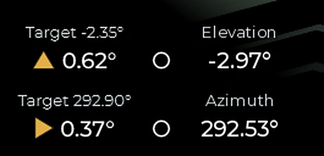

<div align="center">


<p>
  <a href="https://github.com/Akureyri-i/mtc-calc/releases/latest"></a>
  <a href="https://github.com/Akureyri-i/mtc-calc/releases"></a>
  
  <a href="LICENSE"></a>
</p>

<b>English</b> · <a href="README.zh-CN.md">简体中文</a>

</div>

<br>

MTC Calculator is an artillery calculator for [Multicrew Tank Combat](https://www.roblox.com/games/95721658376580/Multicrew-Tank-Combat) that runs on top of the Roblox window. Place markers on the full map as usual: it calculates the elevation, azimuth and charge for each target and shows them next to the game's own readouts.

> [!NOTE]
> The calculator only reads what is shown on screen. It does not read the game's memory, inject anything into Roblox, or send any keyboard or mouse input to the game. Aiming, loading and firing are done by the player.

<p align="center">
  
  <br>
  <sub>A replay of a real match: each marker placed on the full map adds its charge, flight time and arcs to the plan panel.</sub>
</p>

<table>
  <tr>
    <td width="50%" align="center"></td>
    <td width="50%" align="center"></td>
  </tr>
  <tr>
    <td valign="top"><sub>In the gunner seat, the aim strip (left) sits next to the game's readout (right) and shows the target's angles and how far the gun still has to move.</sub></td>
    <td valign="top"><sub>Within the tolerance both dots turn green: ready to fire.</sub></td>
  </tr>
</table>

## Features

<table>
  <tr>
    <td width="40%" valign="top">
      
    </td>
    <td width="60%" valign="top">
      <h3>Plan panel</h3>
      <p>When the full map is open, the plan panel docks next to it and lists the distance, recommended charge and flight time of every marker and objective. Select a target to see its height difference, azimuth, marker precision, both arcs and a terrain profile along the line of fire.</p>
      <p>When a hill or large building blocks the low arc, the panel switches to the high arc or another charge. Trees and small houses cannot be told apart from the ground in the height data, so they are only marked as MAY HIT; when you see it, use a lower charge or the high arc.</p>
      <br>
      <h3>Gunner panel and aim strip</h3>
      
      <p>In the gunner seat, the gunner panel and aim strip sit next to the game's elevation and azimuth readout and show the target's angles and how much is left to adjust.</p>
    </td>
  </tr>
  <tr>
    <td colspan="2">
      <h3>Loading hints</h3>
      
      <p>When the loading menu is open, each charge of each shell has a dot: green if it reaches the selected target, red if it does not. The panel also shows the recommended charge.</p>
    </td>
  </tr>
</table>

**Also**

- Recognises the current map and your gun position; open the full map once and it is set.
- Shows the predicted landing point on the map and detects where each shell actually lands.
- If the shell, charge or gun is recognised wrongly or not at all, click the SHELL or CHARGE row on the panel and choose it yourself. The choice stays with that ammo slot; choose Auto to go back to what is recognised.
- In a squad with several members placing markers, the top of the plan panel shows the number of markers per letter; click a letter to follow those markers, or click any member's marker on the full map to select it.
- Works on a private server's debug map: turn on "Private server debug map" in the settings.
- Adapts to the window size and Windows display scaling; tested from 100% to 225% (see the FAQ).
- English and Chinese interface, switched at the top right of the settings window; by default it follows the Windows display language.
- Comes with the ammunition data and updates it daily; each map's picture and height data are downloaded the first time the map is used.
- Resource use: about 0.15 to 0.3 of one CPU core and 100 to 200 MB of memory in the matches measured.

## Getting started

1. Download `MTC-Calculator.exe` (about 10 MB) from [Releases](https://github.com/Akureyri-i/mtc-calc/releases/latest) and put it anywhere; there is nothing to install.
2. Start Roblox, join [Multicrew Tank Combat](https://www.roblox.com/games/95721658376580/Multicrew-Tank-Combat), then run the program.
3. Take a gun's gunner seat, press M to open the full map once (to recognise the map and your position) and load a shell (to recognise the shell and charge). When the gunner panel and aim strip appear, the calculator is running.
4. Right-click on the full map to place a marker; its firing solution appears in the plan panel and the gunner panel.

The calculator has no window of its own. Its icon is in the notification area at the bottom right of the screen; right-click it to create a problem report, open the log folder or quit.

**Updating**: quit the old version from its notification area icon, then run the new one in its place. Your settings are kept.

**Requirements**: 64-bit Windows 10 or 11 and the Roblox desktop app.

**Game settings**: the calculator reads the game's default interface. Please check:

- In the game's settings, GUNNER section: Align action bar Center, Action bar color #F0B74A, Hide minimap when aiming OFF, Weapon selection layout Horizontal, Keep action bar expanded while loading ON.
- Turn off Roblox's automatic translation and keep the game in English.
- Do not use a font pack that replaces the game's fonts. Keep Text Size in Roblox's settings at the default or one step up; at two steps or more the game cuts its own text short and the calculator cannot read it.
- If Roblox runs as administrator, run the calculator as administrator too.

On first start the calculator asks whether to send anonymous statistics. Nothing is sent until you choose Send, and you can change it at any time in the DIAGNOSTICS section of the settings. When what is collected grows, players who chose Send are asked again.

## Privacy

The calculator runs on your PC, reads only the Roblox window, does not record what you type, and keeps its logs on your disk. With statistics on, it sends numeric records of shots and runs, without screenshots, player names or file paths. Problem reports are created on your PC and are only shared if you send them yourself. See [PRIVACY.md](PRIVACY.md) for details.

## FAQ

<details>
<summary><b>Is this a cheat?</b></summary>
<br>
The calculator does what a screen recorder does: it reads frames of the Roblox window and draws its own windows on top. It does not read, change or automate anything in Roblox, and every shot is aimed, loaded and fired by the player.
</details>

<details>
<summary><b>Which guns are supported?</b></summary>
<br>
Every weapon the game's data marks as artillery: self-propelled and towed guns, mortars and rocket launchers. The muzzle position was measured in game for the M109, M109A6, 2S33, D-30, Centurion AVRE and 60 mm mortar; the others use the closest measured gun. The Sturmtiger's 380 mm rocket is marked as artillery in the data but has not been tested. Tank shells (such as the 125 mm gun's 3OF26) are not supported, as the game shows no elevation readout for them.
</details>

<details>
<summary><b>My screen is not 2560×1440. Does it work?</b></summary>
<br>
Usually. The calculator adapts to the window size and Windows display scaling. It was developed mainly at 2560×1440 and 150%, a full match was played at 1920×1080 and 100%, and 175%, 200% and 225% were tested on a 2560×1440 screen. Other screen sizes and scalings have not each been tested; if something is not recognised, please create a problem report as described below.
</details>

<details>
<summary><b>The shots miss. What should I check?</b></summary>
<br>

- Is the gun position current? After moving the vehicle, zoom in on the full map until your arrow is clearly visible, then click UPDATE GUN on the panel.
- Does the panel say MAY HIT? A shell can hit trees or houses on the way; use a lower charge or the high arc.
- Were both dots of the aim strip green when you fired?

If shots still land far off after these checks, please create a problem report and, if you can, a screen recording of the landing.
</details>

<details>
<summary><b>How do I turn on the shell flight shown in the promotional video?</b></summary>
<br>
The shell flight in the video was made separately; the calculator does not show it. The plan panel and gunner panel show each target's flight time.
</details>

<details>
<summary><b>Windows says it protected my PC. Is it safe?</b></summary>
<br>
Windows shows this for programs that are not signed with a paid certificate, and this program is not signed. Click <i>More info</i>, then <i>Run anyway</i>. All source code is in this repository, and you can build the program yourself (see below).
</details>

<details>
<summary><b>How do I report a problem?</b></summary>
<br>
Open the settings (the gear on the panel), click <i>Create report</i> in the Problem report row, and attach the selected zip file to a GitHub issue. If the panel does not appear, right-click the calculator's icon in the notification area and choose <i>Create problem report</i>. If the problem is something you can see, tick <i>Screenshots</i>: the report then includes the parts of the screen the calculator reads and pictures from recent moments it failed to recognise something; player names in the seat menu are blacked out.
</details>

## Known issues

- On desert maps (Dustbowl II) the gunner panel and aim strip can flicker: the angle readout over bright sand is sometimes not recognised. If it happens to you, please create a problem report with *Screenshots* ticked.
- Some shells land 100–250 m from the predicted point although they were fired at the solution. The cause is not known yet; a problem report and a screen recording of the landing help.
- Trees and small houses are only marked as MAY HIT; flat shots with a low charge can hit them.
- Target marks jitter a little while you drag the full map.
- On Zone 11 the full map is matched less reliably, and targets can flicker.
- Near the edge of a charge's range the recommended charge can switch back and forth.
- At 1920×1080 it uses about twice the CPU it does at 2560×1440 (around 0.3 of one core).
- Standing on your own empty vehicle's map icon after getting out, the gun position may not update.

Not supported yet: a manual mode without the map, salvos, and counting the rounds left.

## Translations

The interface text is in language files under `crates/mtc-overlay/lang/` (`en.json` for English, `zh-CN.json` for Chinese). Pull requests adding a language or improving a translation are welcome; they are released in the next version and credited in the release notes. The game's own words (charges, shell and gun names, key letters) stay in English, as the game shows them.

## Building from source

You need Windows and a recent stable Rust (edition 2024).

```powershell
cargo build --release
cargo test --release
```

That build opens a console window for its output, which is useful while developing. The release program is built with `cargo build --release -p mtc-hud --features gui`: no console, and the output goes only to the log file.

Tests that need recorded gameplay skip themselves when the recordings are not on the machine.

## Credits

- [artillery-calculator](https://github.com/grand-hawk/artillery-calculator) by grand-hawk (MIT): the ballistics model and map configuration this project started from. Its map service provides the map pictures and height data.
- The [MTC wiki](https://multicrew.wiki) data service: weapon and ammunition data.
- [Montserrat](https://github.com/JulietaUla/Montserrat) (SIL Open Font License): the game's interface font, used to read the game's text and to draw the calculator's interface.

Multicrew Tank Combat and Roblox belong to their respective owners. This is a fan-made tool and is not affiliated with Roblox Corporation or the game's developers.

Released under the [MIT license](LICENSE).
