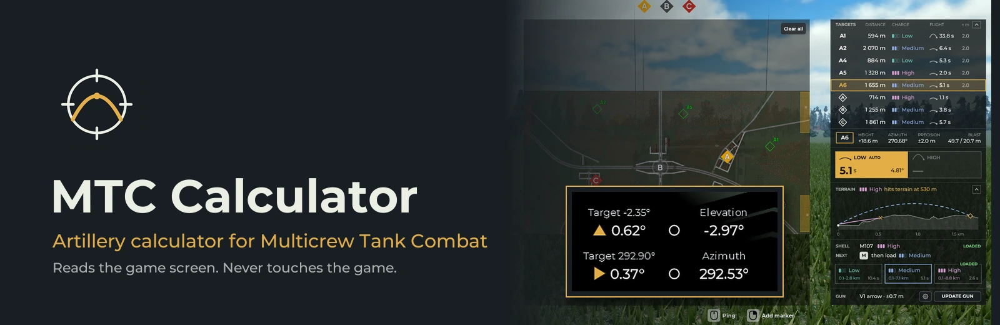
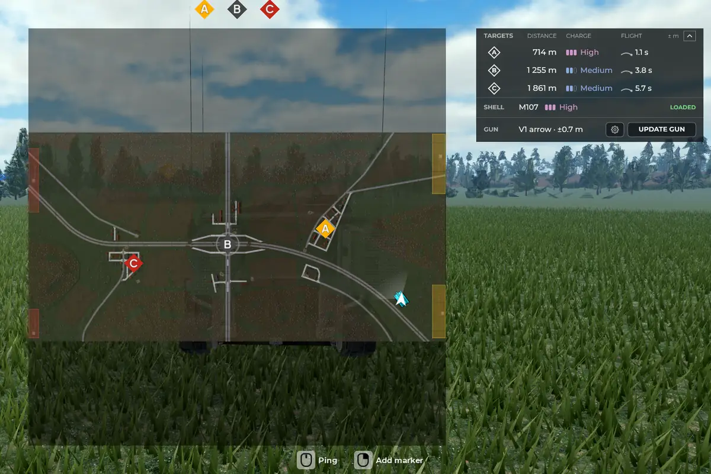
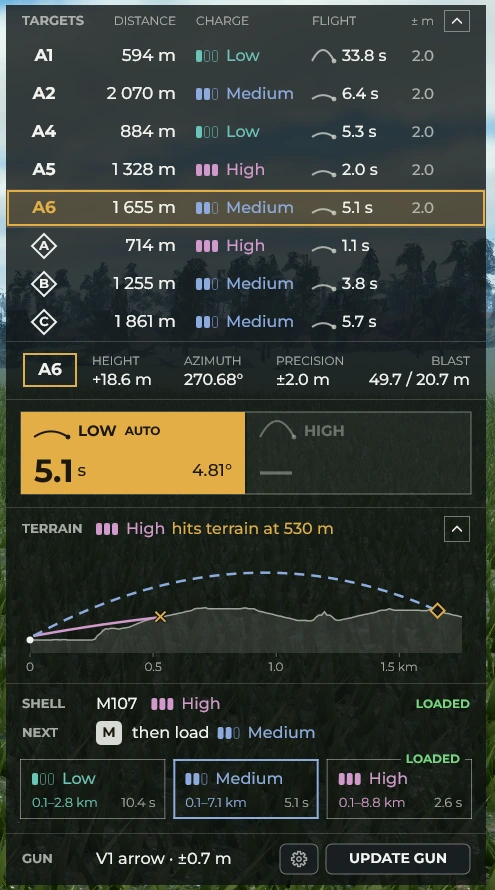
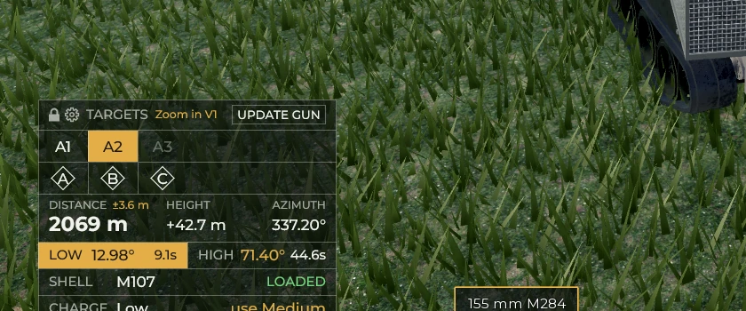
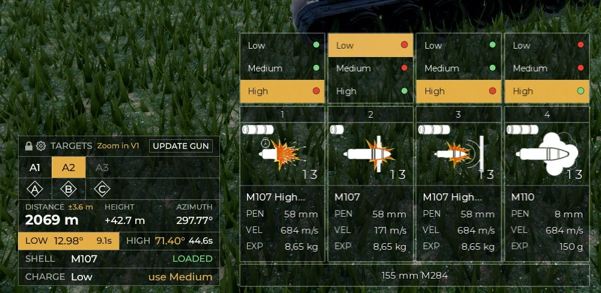

<div align="center">



<p>
  <a href="https://github.com/Akureyri-i/mtc-calc/releases/latest"></a>
  <a href="https://github.com/Akureyri-i/mtc-calc/releases"></a>
  
  <a href="LICENSE"></a>
</p>

<b>English</b> · <a href="README.zh-CN.md">简体中文</a>

</div>

<br>

MTC Calculator sits on top of Roblox while you crew the artillery in Multicrew Tank Combat. Mark targets on the map the way you always do: it works out the elevation, azimuth and charge for each one and shows them right beside the game's own readouts.

> [!NOTE]
> It only looks at the picture on your screen. It does not read the game's memory, inject anything into Roblox, or send a single keystroke or click to the game. Aiming, loading and firing stay yours.

<p align="center">
  
  <br>
  <sub>A real match replayed: each marker you place on the full map gets its charge, flight time and arcs.</sub>
</p>

## What it does

<table>
  <tr>
    <td width="40%" valign="top">
      
    </td>
    <td width="60%" valign="top">
      <h3>Every target in one panel</h3>
      <p>Open the full map and the plan panel docks beside it: distance, charge and flight time for each marker and objective. Pick one and you get its height, azimuth, how precisely it was placed, both arcs, and a terrain profile along the line of fire.</p>
      <p>If a hill or a building is in the way of the low arc, it switches to the high arc or another charge for you. Trees and small houses only get a warning, because shells often clear them.</p>
      <br>
      <h3>Lay the gun from the readout</h3>
      
      <p>In the gunner seat a compact panel and an aim strip sit next to the game's elevation and azimuth readout, showing the target's angles and how far you still have to move.</p>
    </td>
  </tr>
  <tr>
    <td colspan="2">
      <h3>Load what reaches</h3>
      
      <p>When the loading menu is open, every charge of every shell gets a dot: green if it reaches the selected target, red if it does not. The panel names the charge to use.</p>
    </td>
  </tr>
</table>

**Also**

- Recognises the map and your gun's position by itself; open the full map once and it is set.
- Draws the predicted landing point on the map, and spots where each shell actually lands.
- Works at any window size and Windows display scaling.
- Downloads map pictures, heightmaps and ammunition data on first use and keeps them up to date.
- Light on your PC: about 0.15 of one CPU core and under 100 MB of memory in the matches we measured.

## Getting started

1. Download the latest version from [Releases](https://github.com/Akureyri-i/mtc-calc/releases/latest) and unzip it anywhere.
2. Start Roblox, join Multicrew Tank Combat, then run `mtc-hud.exe`.
3. Take an artillery seat and open the full map once. Mark targets as usual.

Needs 64-bit Windows 10 or 11 and the Roblox desktop app.

On first start it asks whether you want to share anonymous statistics that help tune the calculator. It is off unless you say yes, and you can change it any time in the settings (the gear on the panel).

## Privacy

The calculator works on your PC. It looks at the Roblox window only, never records what you type, and keeps logs on your own disk. If you turn statistics on, it sends plain numbers about shots and runs: no screenshots, no player names, no file paths. Problem reports are made on your PC and go nowhere unless you send them yourself. The full details are in [PRIVACY.md](PRIVACY.md).

## FAQ

<details>
<summary><b>Is this a cheat?</b></summary>
<br>
It does nothing a screen recorder doesn't: it looks at frames of the Roblox window and draws its own windows on top. Nothing inside Roblox is read, changed or automated, and every shot is still aimed, loaded and fired by you.
</details>

<details>
<summary><b>Which guns does it support?</b></summary>
<br>
Every weapon the game's data marks as artillery: self-propelled and towed guns, mortars and rocket launchers. Where each gun's shell leaves the barrel was measured in game for the M109 and M109A6, 2S33, D-30, Centurion AVRE and the 60 mm mortar; the others borrow the closest measured one.
</details>

<details>
<summary><b>My screen is not 1440p. Does it still work?</b></summary>
<br>
Yes. It adapts to the window size and the Windows scaling setting; we play it on a 2560×1440 screen at 150 % and tested a full match at 1920×1080 at 100 %.
</details>

<details>
<summary><b>Something looks wrong. How do I report it?</b></summary>
<br>
Open the settings, choose <i>Create report</i> under Problem report, and attach the folder it opens to a GitHub issue. Tick <i>Screenshots</i> if the problem is something you can see; player names are blacked out.
</details>

## Building from source

You need Windows and a recent stable Rust (edition 2024).

```powershell
cargo build --release
cargo test --release
```

The tests that need recorded gameplay skip themselves when the recordings are not on the machine.

## Credits

- [artillery-calculator](https://github.com/grand-hawk/artillery-calculator) by grand-hawk (MIT): the ballistics model and map configuration this project started from. Its map service provides the map pictures and heightmaps.
- The [MTC wiki](https://multicrew.wiki) data service: weapons and ammunition.
- [Montserrat](https://github.com/JulietaUla/Montserrat) (SIL Open Font License): the game's interface font, used to read the game's text and to draw ours.

Multicrew Tank Combat and Roblox belong to their respective owners. This is a fan-made tool and is not affiliated with Roblox Corporation or the game's developers.

Released under the [MIT license](LICENSE).
