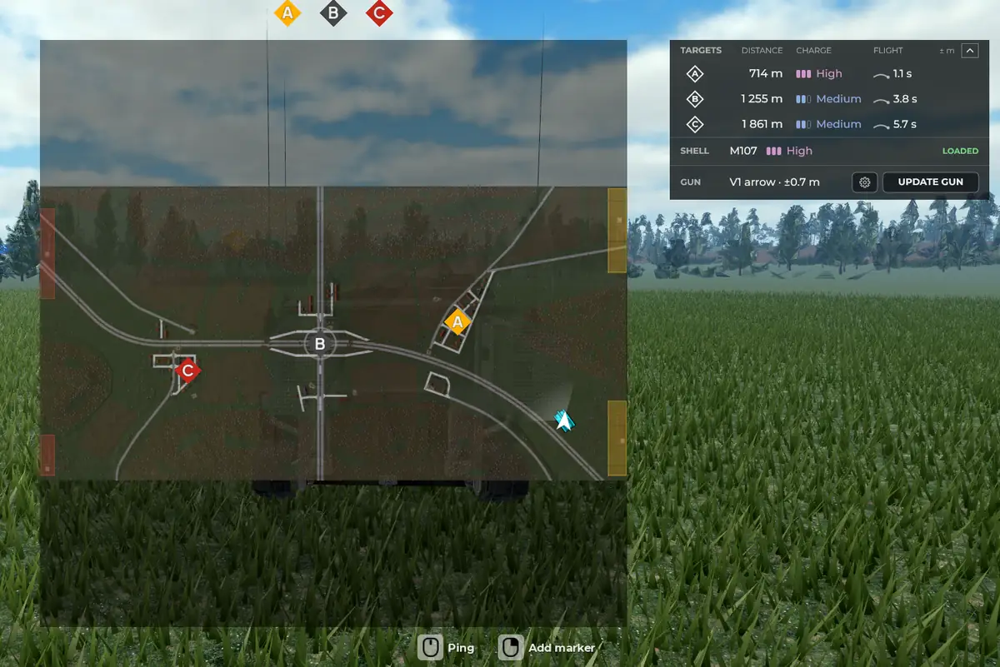
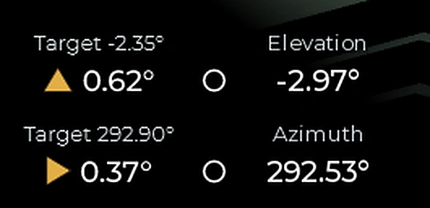
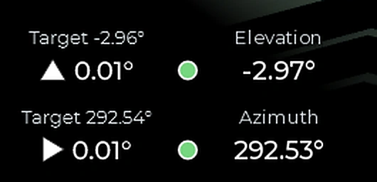
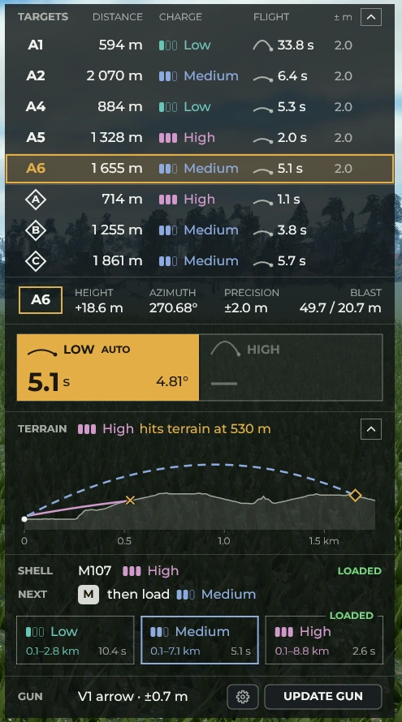
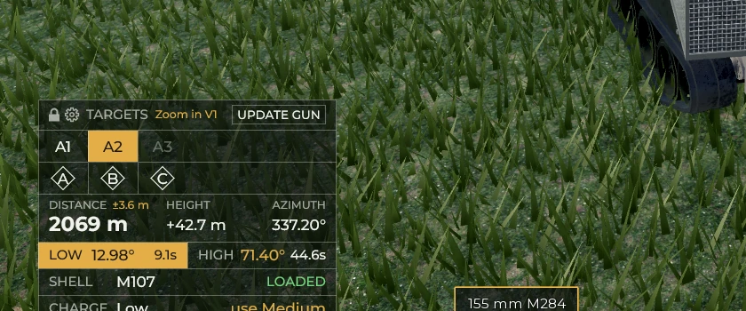

<div align="center">


<p>
  <a href="https://github.com/Akureyri-i/mtc-calc/releases/latest"></a>
  <a href="https://github.com/Akureyri-i/mtc-calc/releases"></a>
  
  <a href="LICENSE"></a>
</p>

<a href="README.md">English</a> · <b>简体中文</b>

</div>

<br>

在 [Multicrew Tank Combat](https://www.roblox.com/games/95721658376580/Multicrew-Tank-Combat) 里玩火炮时，MTC Calculator 叠在 Roblox 画面上工作。你照常在地图上标点，它算出每个目标的仰角、方位和装药，直接显示在游戏自己的读数旁边。

> [!NOTE]
> 它只看你屏幕上的画面：不读游戏内存，不往 Roblox 里注入任何东西，也不会替你按任何一个键、点任何一下鼠标。瞄准、装填、开火都由你自己来。

<p align="center">
  
  <br>
  <sub>真实对局的回放：在大地图上每标一个点，就多出它的装药、飞行时间和弹道。</sub>
</p>

<table>
  <tr>
    <td width="50%" align="center"></td>
    <td width="50%" align="center"></td>
  </tr>
  <tr>
    <td valign="top"><sub>坐在炮手位时，指示条（左）贴着游戏自己的读数（右），告诉你目标角度，以及还要抬多少、转多少。</sub></td>
    <td valign="top"><sub>进入容差范围后，两个圈都变绿，可以开火了。</sub></td>
  </tr>
</table>

## 能做什么

<table>
  <tr>
    <td width="40%" valign="top">
      
    </td>
    <td width="60%" valign="top">
      <h3>所有目标，一个面板</h3>
      <p>打开大地图，计划面板就贴在旁边：每个标点和据点的距离、装药、飞行时间一目了然。选中一个，还能看到高差、方位、标点的精度、高低两条弹道，以及沿射向的地形剖面。</p>
      <p>低弹道会被山坡或建筑挡住时，它会自动换成高弹道或别的装药。树和小房子只提示一下，因为炮弹多半能越过去。</p>
      <br>
      <h3>对着读数装定</h3>
      
      <p>坐在炮手位时，一个小面板和指示条贴在游戏的仰角、方位读数旁边，告诉你目标的角度，以及还差多少要转。</p>
    </td>
  </tr>
  <tr>
    <td colspan="2">
      <h3>装能打到的</h3>
      
      <p>打开装填菜单时，每种弹的每档装药旁边都有一个点：绿点表示能打到选中的目标，红点表示打不到。面板上会直接告诉你该用哪档。</p>
    </td>
  </tr>
</table>

**另外**

- 自己认出是哪张地图、你的炮在哪；打开一次大地图就设好了。
- 在地图上画出预测落点，也能认出每发炮弹实际落在哪里。
- 按窗口大小和 Windows 显示缩放自己适配：100% 到 225% 都实测过（见下方常见问题）。
- 自带所有地图的图片和高度图；弹药数据第一次用时自动下载，之后自己保持最新。
- 占用不高：我们实测的对局里约 0.15 到 0.3 个 CPU 核心，内存 100 到 200 MB。

## 开始使用

1. 从 [Releases](https://github.com/Akureyri-i/mtc-calc/releases/latest) 下载 `MTC-Calculator.exe`，放在任意位置，不用安装。
2. 打开 Roblox 进入 [Multicrew Tank Combat](https://www.roblox.com/games/95721658376580/Multicrew-Tank-Combat)，再运行 `MTC-Calculator.exe`。
3. 坐上火炮，打开一次大地图，照常标点就行。

它没有自己的窗口：屏幕右下角通知区里有它的图标，右键可以打开日志文件夹或退出。

需要 64 位的 Windows 10 或 11，以及 Roblox 桌面版。

计算器是照着游戏原本的样子认画面的，所以请：

- 游戏设置的 GUNNER 一节这样设：Align action bar 选 Center，Action bar color 是 #F0B74A，Hide minimap when aiming 选 OFF，Weapon selection layout 选 Horizontal，Keep action bar expanded while loading 选 ON。
- 关掉 Roblox 的自动翻译，游戏界面保持英文。
- 不要装替换游戏字体的字体包；Roblox 设置里的“文本大小”保持默认。
- Roblox 以管理员身份运行时，计算器也要以管理员身份运行。

第一次启动时会问你愿不愿意分享匿名统计数据，用来把计算器调得更准。你不点同意就不会发，之后也随时可以在设置里改（面板上的齿轮）。

## 隐私

计算器在你自己的电脑上运行。它只看 Roblox 窗口，从不记录你打的字，日志也只存在你自己的硬盘上。打开统计数据后，发送的只是每发炮和每次运行的纯数字：没有截图，没有玩家名字，没有文件路径。问题报告在你电脑上生成，你自己不发出去，它就哪儿也不去。详细说明见 [隐私说明](PRIVACY.zh-CN.md)。

## 常见问题

<details>
<summary><b>这算外挂吗？</b></summary>
<br>
它做的事不超过一个录屏软件：看 Roblox 窗口的画面，再在上面画自己的窗口。Roblox 里的任何东西都不读取、不修改、不自动操作，每一发炮仍然是你自己瞄准、装填、开火。
</details>

<details>
<summary><b>支持哪些炮？</b></summary>
<br>
游戏数据里标为火炮的武器都支持：自行火炮、牵引炮、迫击炮和火箭炮。M109、M109A6、2S33、D-30、Centurion AVRE 和 60 mm 迫击炮的出膛位置在游戏里实测过，其余的借用最接近的那一门。
</details>

<details>
<summary><b>我的屏幕不是 2K，能用吗？</b></summary>
<br>
一般能。它会按窗口大小和 Windows 缩放自己适配：我们平时在 2560×1440、150% 缩放下玩，在 1920×1080、100% 下完整打过一局，也在 2560×1440 上试过 175%、200%、225%。别的屏幕尺寸和缩放没有一一测过，碰到认不出的地方，请用面板齿轮里的 Problem report 生成报告发给我们。
</details>

<details>
<summary><b>Windows 提示“已保护你的电脑”，安全吗？</b></summary>
<br>
没有花钱买证书签名的程序，Windows 都会这样提示，这个程序就没有签名。点“更多信息”，再点“仍要运行”就行。源代码全部公开在这里，你也可以自己编译（见下文）。
</details>

<details>
<summary><b>出问题了怎么反馈？</b></summary>
<br>
打开设置，在“Problem report”下点“Create report”，把打开的文件夹附到 GitHub Issue 里。如果问题是看得见的，勾上“Screenshots”；截图里的玩家名字会被涂黑。
</details>

## 从源码构建

需要 Windows 和较新的稳定版 Rust（edition 2024）。

```powershell
cargo build --release
cargo test --release
```

这样编出来的程序会开一个控制台窗口显示输出，开发时方便。发布版用 `cargo build --release -p mtc-hud --features gui` 编译：没有控制台，输出只写进日志文件。

需要游戏录像的测试在本机没有录像时会自动跳过。

## 致谢

- grand-hawk 的 [artillery-calculator](https://github.com/grand-hawk/artillery-calculator)（MIT）：本项目最初的弹道模型和地图配置来自它，地图图片和高度图也由它的地图服务提供。
- [MTC wiki](https://multicrew.wiki) 的数据服务：武器和弹药数据。
- [Montserrat](https://github.com/JulietaUla/Montserrat) 字体（SIL Open Font License）：游戏界面用的字体，我们用它读游戏里的字，也用它画自己的界面。

Multicrew Tank Combat 和 Roblox 归各自的所有者。本项目是玩家自制的工具，与 Roblox 公司及游戏开发方没有关联。

本项目以 [MIT 许可证](LICENSE) 发布。
