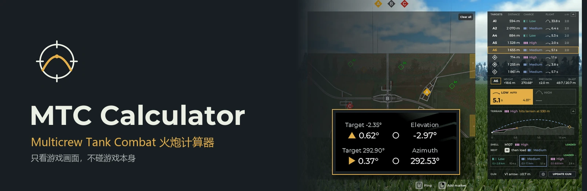
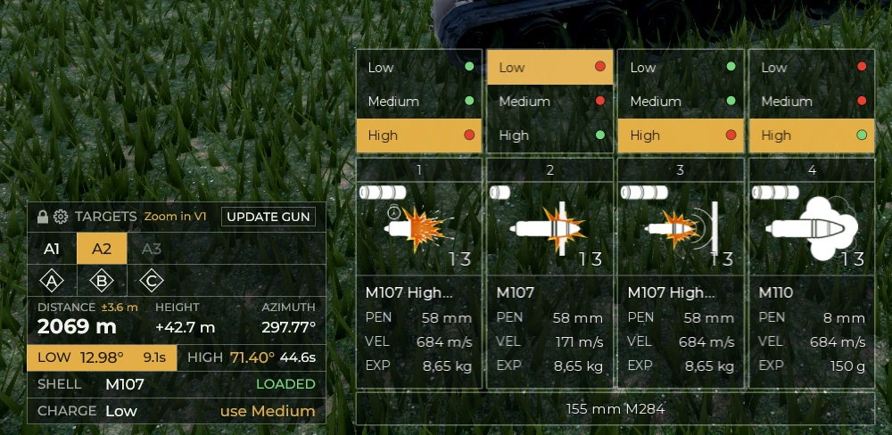

<div align="center">



<p>
  <a href="https://github.com/Akureyri-i/mtc-calc/releases/latest"></a>
  <a href="https://github.com/Akureyri-i/mtc-calc/releases"></a>
  
  <a href="LICENSE"></a>
</p>

<a href="README.md">English</a> · <b>简体中文</b>

</div>

<br>

MTC Calculator 是 [Multicrew Tank Combat](https://www.roblox.com/games/95721658376580/Multicrew-Tank-Combat) 的火炮计算器，运行时显示在 Roblox 画面上方。玩家在大地图上标点后，它计算每个目标的仰角、方位和装药，显示在游戏自身的读数旁边。

> [!NOTE]
> 计算器只读取屏幕上显示的画面，不读取游戏内存，不向 Roblox 注入任何内容，也不向游戏发送任何键盘或鼠标输入。瞄准、装填和开火均由玩家自己操作。

<p align="center">
  
  <br>
  <sub>实际对局的回放：在大地图上每放一个标点，计划面板中即增加该目标的装药、飞行时间和弹道。</sub>
</p>

<table>
  <tr>
    <td width="50%" align="center"></td>
    <td width="50%" align="center"></td>
  </tr>
  <tr>
    <td valign="top"><sub>在炮手位时，指示条（左）显示在游戏读数（右）旁边，标出目标角度以及仰角、方位还需调整多少。</sub></td>
    <td valign="top"><sub>进入容差范围后两个圆点变为绿色，表示可以开火。</sub></td>
  </tr>
</table>

## 功能

<table>
  <tr>
    <td width="40%" valign="top">
      
    </td>
    <td width="60%" valign="top">
      <h3>计划面板</h3>
      <p>打开大地图时，计划面板显示在地图旁边，列出每个标点和据点的距离、推荐装药和飞行时间。选中一个目标后，还会显示高差、方位、标点精度、高低两条弹道和沿射向的地形剖面。</p>
      <p>低弹道被山体或大型建筑挡住时，面板自动改用高弹道或其他装药。树木和小型房屋在高度数据中无法与地面区分，只标注“可能受阻”；遇到这一提示时，建议换用更低的装药或高弹道。</p>
      <br>
      <h3>炮手面板与指示条</h3>
      
      <p>坐在炮手位时，炮手面板和指示条显示在游戏的仰角、方位读数旁边，标出目标角度和还需调整的量。</p>
    </td>
  </tr>
  <tr>
    <td colspan="2">
      <h3>装填提示</h3>
      
      <p>打开装填菜单时，每种弹的每档装药旁有一个圆点：绿色表示能打到选中的目标，红色表示打不到。面板上同时显示推荐使用的装药。</p>
    </td>
  </tr>
</table>

**其他功能**

- 自动识别当前地图和自己的炮位，打开一次大地图即可完成设置。
- 在地图上显示预测落点，并识别每发炮弹的实际落点。
- 弹种、装药或火炮识别有误或未识别时，可点击面板上的“弹种”“装药”一行手动选择；选择保存在对应的弹药栏格子上，选“自动”恢复识别结果。
- 小队中有多名成员标点时，计划面板顶部显示各字母的标点数，点击即可切换跟随的标点；在大地图上点击任意成员的标点也可直接选中。
- 支持私人服的调试地图：在设置中打开“私人服调试地图”。
- 按窗口大小和 Windows 显示缩放自动适配，已在 100% 至 225% 下测试（见下方常见问题）。
- 界面提供中文和英文，在设置窗口右上角切换；未设置时跟随 Windows 显示语言。
- 随程序附带弹药数据，之后每天自动更新；每张地图的图片和高度数据在首次用到时下载。
- 资源占用：实测对局中约 0.15 至 0.3 个 CPU 核心，内存 100 至 200 MB。

## 开始使用

1. 从 [Releases](https://github.com/Akureyri-i/mtc-calc/releases/latest) 下载 `MTC-Calculator.exe`（约 10 MB），放在任意位置即可运行，无需安装。
2. 打开 Roblox 进入 [Multicrew Tank Combat](https://www.roblox.com/games/95721658376580/Multicrew-Tank-Combat)，然后运行程序。
3. 坐上火炮的炮手位，按 M 打开一次大地图（用于识别地图和炮位），装填一发炮弹（用于识别弹种和装药）。屏幕上出现炮手面板和指示条即表示计算器已开始工作。
4. 在大地图上用鼠标右键标点，计划面板和炮手面板中即出现该目标的射击方案。

计算器没有自己的窗口，运行时的图标位于屏幕右下角的通知区域；右键单击图标可生成问题报告、打开日志文件夹或退出。

**更新版本**：先在通知区域图标的右键菜单中退出旧版本，再运行新版本替换即可，设置会保留。

B 站有玩家制作的使用教程：[MTC 全新智能火炮计算器手把手使用教学](https://b23.tv/mUuyNY7)。

**系统要求**：64 位 Windows 10 或 11，Roblox 桌面版。

**游戏设置**：计算器按游戏的默认界面识别画面，请确认以下设置：

- 游戏设置的 GUNNER 一节：Align action bar 设为 Center，Action bar color 为 #F0B74A，Hide minimap when aiming 设为 OFF，Weapon selection layout 设为 Horizontal，Keep action bar expanded while loading 设为 ON。
- 关闭 Roblox 的自动翻译，游戏界面保持英文。
- 不要使用替换游戏字体的字体包。Roblox 设置中的“文本大小”保持默认或调大一格；调大两格及以上时游戏会截断自身文字，计算器无法读取。
- Roblox 以管理员身份运行时，计算器也需以管理员身份运行。

首次启动时，计算器会询问是否发送匿名统计数据。选择“发送”之前不会发送任何数据；之后可在设置的“诊断”一节随时更改。收集的内容增加时，已选择发送的玩家会再次被询问。

## 隐私

计算器在本机运行，只读取 Roblox 窗口的画面，不记录键盘输入的文字，日志只保存在本机。开启统计数据后，发送的是每发炮弹和每次运行的数值记录，不包含截图、玩家名或文件路径。问题报告在本机生成，由玩家自行决定是否发送。详见[隐私说明](PRIVACY.zh-CN.md)。

## 常见问题

<details>
<summary><b>这算外挂吗？</b></summary>
<br>
计算器做的事情与录屏软件相同：读取 Roblox 窗口的画面，并在其上方显示自己的窗口。它不读取、不修改、也不自动操作 Roblox 中的任何内容，每一发炮弹都由玩家自己瞄准、装填和开火。
</details>

<details>
<summary><b>支持哪些火炮？</b></summary>
<br>
支持游戏数据中标为火炮的武器，包括自行火炮、牵引火炮、迫击炮和火箭炮。M109、M109A6、2S33、D-30、Centurion AVRE 和 60 mm 迫击炮的炮口位置经过实测，其余火炮沿用最接近的已测火炮的数据。突击虎的 380 mm 火箭在数据中标为火炮，但尚未测试。坦克炮弹（例如 125 mm 炮的 3OF26）游戏不显示俯仰读数，不在支持范围内。
</details>

<details>
<summary><b>我的屏幕不是 2560×1440，能用吗？</b></summary>
<br>
通常可以。计算器按窗口大小和 Windows 显示缩放自动适配：开发时主要在 2560×1440、150% 下使用，在 1920×1080、100% 下完成过完整对局，并在 2560×1440 上测试过 175%、200% 和 225%。其他屏幕尺寸和缩放没有逐一测试；遇到无法识别的情况，请按下文生成问题报告。
</details>

<details>
<summary><b>打得不准怎么办？</b></summary>
<br>
请先确认以下几点：

- 炮位是否为最新：移动过车辆后，在大地图上放大到能看清自己的箭头，再点击面板上的“更新炮位”。
- 面板是否提示“可能受阻”：弹道经过树木或房屋时，炮弹可能中途撞上；可换用更低的装药或高弹道。
- 开炮时指示条的两个圆点是否都为绿色。

确认以上几点后仍明显偏离的，请生成问题报告，并尽量附上落点的录屏。
</details>

<details>
<summary><b>宣传视频中的炮弹飞行过程在哪里打开？</b></summary>
<br>
视频中的炮弹飞行画面是单独制作的，计算器本身不显示这一过程。计划面板和炮手面板会显示每个目标的预计飞行时间。
</details>

<details>
<summary><b>下载很慢怎么办？</b></summary>
<br>
GitHub 在中国大陆访问可能较慢或不稳定，可以加入 QQ 反馈群 578437313，从群文件下载。
</details>

<details>
<summary><b>Windows 提示“已保护你的电脑”，是否安全？</b></summary>
<br>
未使用付费证书签名的程序都会出现这一提示，本程序没有签名。点击“更多信息”，再点击“仍要运行”即可。全部源代码在本仓库公开，也可以自行编译（见下文）。
</details>

<details>
<summary><b>遇到问题如何反馈？</b></summary>
<br>
打开设置（面板上的齿轮图标），在“问题报告”一行点击“生成报告”，然后将选中的 zip 文件附到 GitHub Issue 中（或直接发到 QQ 群）。面板没有出现时，可右键单击通知区域中的计算器图标，选择“生成问题报告”。问题与画面显示有关时，请勾选“附截图”：报告会附上计算器读取的几处画面，以及最近几次识别失败时的画面，座位菜单中的玩家名会被涂黑。
</details>

## 已知问题

- 在沙漠地图（Dustbowl II）上，炮手面板和指示条可能闪烁：亮色沙地背景下的角度读数有时无法识别。遇到时请勾选“附截图”生成问题报告。
- 部分炮弹按射击方案开火后，落点仍偏离预测 100–250 m，原因尚未查明。问题报告和落点的录屏有助于排查。
- 树木和小型房屋只标注“可能受阻”，低装药平射时可能撞上。
- 拖动大地图时，目标标注会轻微抖动。
- Zone 11 的大地图配准不够稳定，目标可能时有时无。
- 在某档装药的射程边缘，推荐装药可能来回切换。
- 1920×1080 下的 CPU 占用约为 2560×1440 的两倍（约 0.3 个核心）。
- 下车后站在自己的空车图标上时，炮位可能不更新。

尚未支持：不依赖地图的手动模式、齐射、剩余弹数统计。

## 界面翻译

界面文字保存在 `crates/mtc-overlay/lang/` 下的语言文件中（`en.json` 为英文，`zh-CN.json` 为中文）。欢迎通过 Pull Request 提交其他语言的翻译或修改现有翻译；合并后会在下一个版本中发布，并在更新说明中致谢。游戏自身的词语（装药、弹种和炮名、按键字母）保持英文，与游戏界面一致。

## 从源码构建

需要 Windows 和较新的稳定版 Rust（edition 2024）。

```powershell
cargo build --release
cargo test --release
```

这样编译出的程序会打开控制台窗口显示输出，便于开发。发布版使用 `cargo build --release -p mtc-hud --features gui` 编译：不显示控制台，输出只写入日志文件。

需要游戏录像的测试在本机没有录像时会自动跳过。

## 致谢

- grand-hawk 的 [artillery-calculator](https://github.com/grand-hawk/artillery-calculator)（MIT）：本项目最初的弹道模型和地图配置来自该项目，地图图片和高度数据也由其地图服务提供。
- [MTC wiki](https://multicrew.wiki) 的数据服务：武器和弹药数据。
- [Montserrat](https://github.com/JulietaUla/Montserrat) 字体（SIL Open Font License）：游戏界面使用的字体，计算器用它识别游戏文字，并绘制自己的界面。

Multicrew Tank Combat 和 Roblox 归各自的所有者所有。本项目为玩家自制工具，与 Roblox 公司及游戏开发方无关。

本项目以 [MIT 许可证](LICENSE) 发布。
